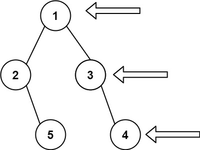

# LCR 046. 二叉树的右视图

Medium · [力扣原题](https://leetcode.cn/problems/WNC0Lk/)

| 作者 | 题解 | 动画讲解 |
|---|---|---|
| 灵茶山艾府 | [📄 题解](灵茶山艾府.md) | [▶︎ 动画（GIF）](LCR%20046%20二叉树的右视图%20·%20灵茶山艾府.gif) · [mp4 文件](LCR%20046%20二叉树的右视图%20·%20灵茶山艾府.mp4) |
| yiduobo | — | — |

## 动画讲解

> 动图会循环播放；想暂停、拖进度条请下载上面表格里的 mp4 文件。

### 灵茶山艾府


## 题目描述

给定一个二叉树的 **根节点** `root`，想象自己站在它的右侧，按照从顶部到底部的顺序，返回从右侧所能看到的节点值。

**示例 1：**



```

输入: [1,2,3,null,5,null,4]
输出: [1,3,4]
```

**示例 2：**

```

输入: [1,null,3]
输出: [1,3]
```

**示例 3：**

```

输入: []
输出: []
```

**提示：**

- 二叉树的节点个数的范围是 `[0,100]`

- `-100 <= Node.val <= 100`

注意：本题与主站 199 题相同：[https://leetcode.cn/problems/binary-tree-right-side-view/](https://leetcode.cn/problems/binary-tree-right-side-view/)

---
[↑ 返回 LCR](../README.md) · [总索引](../../../索引.md) · [仓库首页](../../../README.md)
