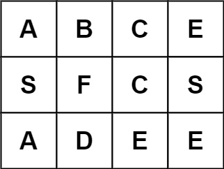

# 极致优化！代码击败接近 100%！（Python/Java/C++/C/Go/JS/Rust）

> **[LCR 129. 字母迷宫](https://leetcode.cn/problems/ju-zhen-zhong-de-lu-jing-lcof/solutions/2962452/ji-zhi-you-hua-dai-ma-ji-bai-jie-jin-100-1w79/) · Medium**

> **题目描述**
> 字母迷宫游戏初始界面记作 `m x n` 二维字符串数组 `grid`，请判断玩家是否能在 `grid` 中找到目标单词 `target`。
>
> 注意：寻找单词时 **必须** 按照字母顺序，通过水平或垂直方向相邻的单元格内的字母构成，同时，同一个单元格内的字母 **不允许被重复使用** 。
>
> 
>
> **示例 1：**
>
> ```
>
> 输入：grid = [["A","B","C","E"],["S","F","C","S"],["A","D","E","E"]], target = "ABCCED"
> 输出：true
> ```
>
> **示例 2：**
>
> ```
>
> 输入：grid = [["A","B","C","E"],["S","F","C","S"],["A","D","E","E"]], target = "SEE"
> 输出：true
> ```
>
> **示例 3：**
>
> ```
>
> 输入：grid = [["A","B","C","E"],["S","F","C","S"],["A","D","E","E"]], target = "ABCB"
> 输出：false
> ```
>
> **提示：**
>
> - `m == grid.length`
>
> - `n = grid[i].length`
>
> - `1 <= m, n <= 6`
>
> - `1 <= target.length <= 15`
>
> - `grid` 和 `target` 仅由大小写英文字母组成
>
> **注意：**本题与主站 79 题相同：[https://leetcode.cn/problems/word-search/](https://leetcode.cn/problems/word-search/)

> **题解**
> ## 前置知识
>
> 做本题前，你需要有一些网格图 DFS 的经验和回溯的经验。
>
> - 关于网格图 DFS，可以做做 [200. 岛屿数量](https://leetcode.cn/problems/number-of-islands/)。
> - 关于回溯，可以看[【基础算法精讲 14】](https://www.bilibili.com/video/BV1mG4y1A7Gu/)。
>
> ## 基本思路（优化前）
>
> 枚举 $i=0,1,2,\cdots,m-1$ 和 $j=0,1,2,\cdots,n-1$，以 $(i,j)$ 为起点开始搜索。
>
> 同时，我们还需要知道当前匹配到了 $\textit{target}$ 的第几个字母，所以还需要一个参数 $k$。
>
> 定义 $\textit{dfs}(i,j,k)$ 表示当前在 $\textit{grid}[i][j]$ 这个格子，要匹配 $\textit{target}[k]$，返回在这个状态下最终能否匹配成功（搜索成功）。
>
> 分类讨论：
>
> - 如果 $\textit{grid}[i][j] \ne \textit{target}[k]$，匹配失败，返回 $\texttt{false}$。
> - 否则，如果 $k=\text{len}(\textit{target})-1$，匹配成功，返回 $\texttt{true}$。
> - 否则，枚举 $(i,j)$ 周围的四个相邻格子 $(x,y)$，如果 $(x,y)$ 没有出界，则递归 $\textit{dfs}(x,y,k+1)$，如果其返回 $\texttt{true}$，则 $\textit{dfs}(i,j,k)$ 也返回 $\texttt{true}$。
> - 如果递归周围的四个相邻格子都没有返回 $\texttt{true}$，则最后返回 $\texttt{false}$，表示没有搜到。
>
> 细节：
>
> - 递归过程中，为了避免重复访问同一个格子，可以用 $\textit{vis}$ 数组标记。更简单的做法是，直接修改 $\textit{grid}[i][j]$，将其置为空（或者 $0$），返回 $\texttt{false}$ 前再恢复成原来的值（恢复现场）。注意返回 $\texttt{true}$ 的时候就不用恢复现场了，因为已经成功搜到 $\textit{target}$ 了。
>
> ```python
> class Solution:
>     def wordPuzzle(self, grid: List[List[str]], target: str) -> bool:
>         m, n = len(grid), len(grid[0])
>         def dfs(i: int, j: int, k: int) -> bool:
>             if grid[i][j] != target[k]:  # 匹配失败
>                 return False
>             if k == len(target) - 1:  # 匹配成功！
>                 return True
>             grid[i][j] = ''  # 标记访问过
>             for x, y in (i, j - 1), (i, j + 1), (i - 1, j), (i + 1, j):  # 相邻格子
>                 if 0 <= x < m and 0 <= y < n and dfs(x, y, k + 1):
>                     return True  # 搜到了！
>             grid[i][j] = target[k]  # 恢复现场
>             return False  # 没搜到
>         return any(dfs(i, j, 0) for i in range(m) for j in range(n))
> ```
>
>
> ## 第一个优化
>
> 
>
> 比如示例 3，$\textit{target}=\texttt{ABCB}$，其中字母 $\texttt{B}$ 出现了 $2$ 次，但 $\textit{grid}$ 中只有 $1$ 个字母 $\texttt{B}$，所以肯定搜不到 $\textit{target}$，直接返回 $\texttt{false}$。
>
> 一般地，如果 $\textit{target}$ 的某个字母的出现次数，比 $\textit{grid}$ 中的这个字母的出现次数还要多，可以直接返回 $\texttt{false}$。
>
> ## 第二个优化
>
> 设 $\textit{target}$ 的第一个字母在 $\textit{grid}$ 中的出现了 $x$ 次，$\textit{target}$ 的最后一个字母在 $\textit{grid}$ 中的出现了 $y$ 次。
>
> 如果 $y<x$，我们可以把 $\textit{target}$ 反转，相当于从 $\textit{target}$ 的最后一个字母开始搜索，这样更容易在一开始就满足 `grid[i][j] != target[k]`，不会往下递归，递归的总次数更少。
>
> 加上这两个优化，就可以击败接近 $100\%$ 了！其中 Java、C++、Go 和 Rust 可以跑到 0ms。
>
> ```python
> class Solution:
>     def wordPuzzle(self, grid: List[List[str]], target: str) -> bool:
>         cnt = Counter(c for row in grid for c in row)
>         if not cnt >= Counter(target):  # 优化一
>             return False
>         if cnt[target[-1]] < cnt[target[0]]:  # 优化二
>             target = target[::-1]
>
>         m, n = len(grid), len(grid[0])
>         def dfs(i: int, j: int, k: int) -> bool:
>             if grid[i][j] != target[k]:  # 匹配失败
>                 return False
>             if k == len(target) - 1:  # 匹配成功！
>                 return True
>             grid[i][j] = ''  # 标记访问过
>             for x, y in (i, j - 1), (i, j + 1), (i - 1, j), (i + 1, j):  # 相邻格子
>                 if 0 <= x < m and 0 <= y < n and dfs(x, y, k + 1):
>                     return True  # 搜到了！
>             grid[i][j] = target[k]  # 恢复现场
>             return False  # 没搜到
>         return any(dfs(i, j, 0) for i in range(m) for j in range(n))
> ```
>
>
> #### 复杂度分析
>
> - 时间复杂度：$\mathcal{O}(mn3^k)$，其中 $m$ 和 $n$ 分别为 $\textit{grid}$ 的行数和列数，$k$ 是 $\textit{target}$ 的长度。除了递归入口，其余递归至多有 $3$ 个分支（因为至少有一个方向是之前走过的），所以每次递归（回溯）的时间复杂度为 $\mathcal{O}(3^k)$，一共回溯 $\mathcal{O}(mn)$ 次，所以时间复杂度为 $\mathcal{O}(mn3^k)$。
> - 空间复杂度：$\mathcal{O}(|\Sigma| + k)$。其中 $|\Sigma|=52$ 是字符集合的大小。递归需要 $\mathcal{O}(k)$ 的栈空间。部分语言用的数组代替哈希表，可以视作 $|\Sigma|=128$。
>
> ## 分类题单
>
> [如何科学刷题？](https://leetcode.cn/circle/discuss/RvFUtj/)
>
> 1. [滑动窗口与双指针（定长/不定长/单序列/双序列/三指针/分组循环）](https://leetcode.cn/circle/discuss/0viNMK/)
> 2. [二分算法（二分答案/最小化最大值/最大化最小值/第K小）](https://leetcode.cn/circle/discuss/SqopEo/)
> 3. [单调栈（基础/矩形面积/贡献法/最小字典序）](https://leetcode.cn/circle/discuss/9oZFK9/)
> 4. [网格图（DFS/BFS/综合应用）](https://leetcode.cn/circle/discuss/YiXPXW/)
> 5. [位运算（基础/性质/拆位/试填/恒等式/思维）](https://leetcode.cn/circle/discuss/dHn9Vk/)
> 6. [图论算法（DFS/BFS/拓扑排序/最短路/最小生成树/二分图/基环树/欧拉路径）](https://leetcode.cn/circle/discuss/01LUak/)
> 7. [动态规划（入门/背包/状态机/划分/区间/状压/数位/数据结构优化/树形/博弈/概率期望）](https://leetcode.cn/circle/discuss/tXLS3i/)
> 8. [常用数据结构（前缀和/差分/栈/队列/堆/字典树/并查集/树状数组/线段树）](https://leetcode.cn/circle/discuss/mOr1u6/)
> 9. [数学算法（数论/组合/概率期望/博弈/计算几何/随机算法）](https://leetcode.cn/circle/discuss/IYT3ss/)
> 10. [贪心与思维（基本贪心策略/反悔/区间/字典序/数学/思维/脑筋急转弯/构造）](https://leetcode.cn/circle/discuss/g6KTKL/)
> 11. [链表、二叉树与回溯（前后指针/快慢指针/DFS/BFS/直径/LCA/一般树）](https://leetcode.cn/circle/discuss/K0n2gO/)
> 12. [字符串（KMP/Z函数/Manacher/字符串哈希/AC自动机/后缀数组/子序列自动机）](https://leetcode.cn/circle/discuss/SJFwQI/)
>
> [我的题解精选（已分类）](https://github.com/EndlessCheng/codeforces-go/blob/master/leetcode/SOLUTIONS.md)
>
> 欢迎关注 [B站@灵茶山艾府](https://space.bilibili.com/206214)
