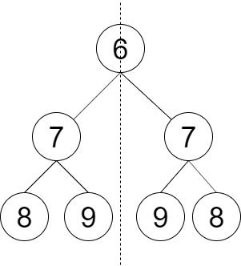
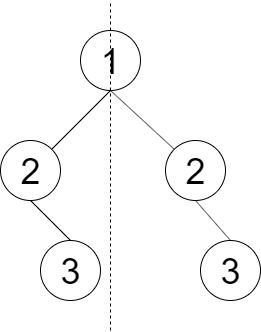

# 【视频】如何灵活运用递归？让你对递归的理解更上一层楼！（Python/Java/C++/Go）

> **[LCR 145. 判断对称二叉树](https://leetcode.cn/problems/dui-cheng-de-er-cha-shu-lcof/solutions/2228140/shi-pin-ru-he-ling-huo-yun-yong-di-gui-r-xjm2/) · Easy**

> **题目描述**
> 请设计一个函数判断一棵二叉树是否 **轴对称** 。
>
> **示例 1：**
>
> 
>
> ```
>
> 输入：root = [6,7,7,8,9,9,8]
> 输出：true
> 解释：从图中可看出树是轴对称的。
> ```
>
> **示例 2：**
>
> 
>
> ```
>
> 输入：root = [1,2,2,null,3,null,3]
> 输出：false
> 解释：从图中可看出最后一层的节点不对称。
> ```
>
> **提示：**
>
> `0 <= 节点个数 <= 1000`
>
> 注意：本题与主站 101 题相同：[https://leetcode.cn/problems/symmetric-tree/](https://leetcode.cn/problems/symmetric-tree/)

> **题解**
> ## 视频讲解
>
> 看完这两期视频，对递归的理解更上一层楼！
>
> [【基础算法精讲 09】](https://www.bilibili.com/video/BV1UD4y1Y769/)
>
> [【基础算法精讲 10】](https://www.bilibili.com/video/BV18M411z7bb/)
>
> 制作不易，欢迎点赞！
>
> ```python
> class Solution:
>     # 在【100. 相同的树】的基础上稍加改动
>     def isSameTree(self, p: Optional[TreeNode], q: Optional[TreeNode]) -> bool:
>         if p is None or q is None:
>             return p is q
>         return p.val == q.val and self.isSameTree(p.left, q.right) and self.isSameTree(p.right, q.left)
>
>     def checkSymmetricTree(self, root: Optional[TreeNode]) -> bool:
>         return root is None or self.isSameTree(root.left, root.right)
> ```
>
>
> #### 复杂度分析
>
> - 时间复杂度：$O(n)$，其中 $n$ 为二叉树的节点个数。
> - 空间复杂度：$O(n)$。最坏情况下，二叉树退化成一条链，递归需要 $O(n)$ 的栈空间。
>
> ## 题单
>
> - [滑动窗口（定长/不定长/多指针）](https://leetcode.cn/circle/discuss/0viNMK/)
> - [二分算法（二分答案/最小化最大值/最大化最小值/第K小）](https://leetcode.cn/circle/discuss/SqopEo/)
> - [单调栈（矩形系列/字典序最小/贡献法）](https://leetcode.cn/circle/discuss/9oZFK9/)
> - [网格图（DFS/BFS/综合应用）](https://leetcode.cn/circle/discuss/YiXPXW/)
> - [位运算（基础/性质/拆位/试填/恒等式/贪心/脑筋急转弯）](https://leetcode.cn/circle/discuss/dHn9Vk/)
> - [图论算法（DFS/BFS/拓扑排序/最短路/最小生成树/二分图/基环树/欧拉路径）](https://leetcode.cn/circle/discuss/01LUak/)
>
> 更多题单，请点我个人主页 - 讨论发布。
