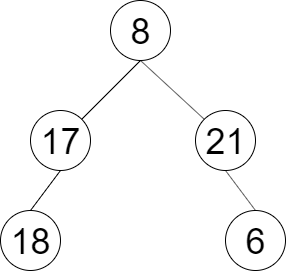

# BFS 为什么要用队列？一个视频讲透！（Python/Java/C++/Go）

> **[LCR 150. 彩灯装饰记录 II](https://leetcode.cn/problems/cong-shang-dao-xia-da-yin-er-cha-shu-ii-lcof/solutions/2294076/bfs-wei-shi-yao-yao-yong-dui-lie-yi-ge-s-bgzr/) · Easy**

> **题目描述**
> 一棵圣诞树记作根节点为 `root` 的二叉树，节点值为该位置装饰彩灯的颜色编号。请按照从左到右的顺序返回每一层彩灯编号，每一层的结果记录于一行。
>
> **示例 1：**
>
> 
>
> ```
>
> 输入：root = [8,17,21,18,null,null,6]
> 输出：[[8],[17,21],[18,6]]
> ```
>
> **提示：**
>
> 1. `节点总数 <= 1000`
>
> 注意：本题与主站 102 题相同：[https://leetcode.cn/problems/binary-tree-level-order-traversal/](https://leetcode.cn/problems/binary-tree-level-order-traversal/)

> **题解**
> ## 视频讲解
>
> 请看[【基础算法精讲 13】](https://www.bilibili.com/video/BV1hG4y1277i/)，制作不易，欢迎点赞~
>
> ## 方法一：两个数组
>
> ```python
> class Solution:
>     def decorateRecord(self, root: Optional[TreeNode]) -> List[List[int]]:
>         if root is None:
>             return []
>         ans = []
>         cur = [root]
>         while cur:
>             nxt = []
>             vals = []
>             for node in cur:
>                 vals.append(node.val)
>                 if node.left:  nxt.append(node.left)
>                 if node.right: nxt.append(node.right)
>             cur = nxt
>             ans.append(vals)
>         return ans
> ```
>
>
> #### 复杂度分析
>
> - 时间复杂度：$\mathcal{O}(n)$，其中 $n$ 为二叉树的节点个数。
> - 空间复杂度：$\mathcal{O}(n)$。满二叉树（每一层都填满）最后一层有大约 $n/2$ 个节点，因此数组中最多有 $\mathcal{O}(n)$ 个元素，所以空间复杂度是 $\mathcal{O}(n)$ 的。
>
> ## 方法二：一个队列
>
> ```python
> class Solution:
>     def decorateRecord(self, root: Optional[TreeNode]) -> List[List[int]]:
>         if root is None:
>             return []
>         ans = []
>         q = deque([root])
>         while q:
>             vals = []
>             for _ in range(len(q)):
>                 node = q.popleft()
>                 vals.append(node.val)
>                 if node.left:  q.append(node.left)
>                 if node.right: q.append(node.right)
>             ans.append(vals)
>         return ans
> ```
>
>
> #### 复杂度分析
>
> - 时间复杂度：$\mathcal{O}(n)$，其中 $n$ 为二叉树的节点个数。
> - 空间复杂度：$\mathcal{O}(n)$。满二叉树（每一层都填满）最后一层有大约 $n/2$ 个节点，因此队列中最多有 $\mathcal{O}(n)$ 个元素，所以空间复杂度是 $\mathcal{O}(n)$ 的。
>
> ## 题单
>
> - [滑动窗口（定长/不定长/多指针）](https://leetcode.cn/circle/discuss/0viNMK/)
> - [二分算法（二分答案/最小化最大值/最大化最小值/第K小）](https://leetcode.cn/circle/discuss/SqopEo/)
> - [单调栈（矩形系列/字典序最小/贡献法）](https://leetcode.cn/circle/discuss/9oZFK9/)
> - [网格图（DFS/BFS/综合应用）](https://leetcode.cn/circle/discuss/YiXPXW/)
> - [位运算（基础/性质/拆位/试填/恒等式/贪心/脑筋急转弯）](https://leetcode.cn/circle/discuss/dHn9Vk/)
> - [图论算法（DFS/BFS/拓扑排序/最短路/最小生成树/二分图/基环树/欧拉路径）](https://leetcode.cn/circle/discuss/01LUak/)
>
> 更多题单，请点我个人主页 - 讨论发布。
