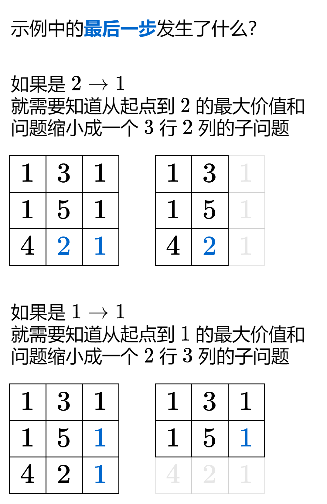

# 教你一步步思考动态规划！从递归到递推到 O(1) 额外空间！（Python/Java/C++/Go）

> **[LCR 166. 珠宝的最高价值](https://leetcode.cn/problems/li-wu-de-zui-da-jie-zhi-lcof/solutions/2153802/jiao-ni-yi-bu-bu-si-kao-dpcong-hui-su-da-epvl/) · Medium**

> **题目描述**
> 现有一个记作二维矩阵 `frame` 的珠宝架，其中 `frame[i][j]` 为该位置珠宝的价值。拿取珠宝的规则为：
>
> - 只能从架子的左上角开始拿珠宝
>
> - 每次可以移动到右侧或下侧的相邻位置
>
> - 到达珠宝架子的右下角时，停止拿取
>
> 注意：珠宝的价值都是大于 0 的。除非这个架子上没有任何珠宝，比如 `frame = [[0]]`。
>
> **示例 1：**
>
> ```
>
> 输入：frame = [[1,3,1],[1,5,1],[4,2,1]]
> 输出：12
> 解释：路径 1→3→5→2→1 可以拿到最高价值的珠宝
> ```
>
> **提示：**
>
> - `0 < frame.length <= 200`
>
> - `0 < frame[0].length <= 200`

> **题解**
> 对于不少动态规划问题，「如何想出状态定义和状态转移方程」是有套路的。我在 [动态规划入门：从记忆化搜索到递推](https://www.bilibili.com/video/BV1Xj411K7oF/) 中讲了「递归->记忆化搜索->递推」的思考套路。本文将遵照这个过程，来讲讲怎么从递归开始，一步步写出最后的递推代码。
>
> ## 一、寻找子问题
>
> 怎么把一个大问题变成小问题？
>
> 
>
> 受上图启发，定义 $\textit{dfs}(i,j)$ 表示从左上角到第 $i$ 行第 $j$ 列这个格子（记作 $(i,j)$）的最大价值和。
>
> 分类讨论怎么到达 $(i,j)$：
>
> - 如果是从左边过来，则 $\textit{dfs}(i,j) = \textit{dfs}(i,j-1) +\textit{grid}[i][j]$；
> - 如果是从上边过来，则 $\textit{dfs}(i,j) = \textit{dfs}(i-1,j) +\textit{grid}[i][j]$。
>
> 这两取最大值，得
>
> $$
> \textit{dfs}(i,j) = \max(\textit{dfs}(i,j-1), \textit{dfs}(i-1,j)) +\textit{grid}[i][j]
> $$
>
> 递归边界：当 $i<0$ 或 $j<0$ 时，返回 $0$，因为出界是没有价值的。也就是 $\textit{dfs}(-1,j)=0,\textit{dfs}(i,-1)=0$。
>
> 递归入口：$\textit{dfs}(m-1,n-1)$。
>
> ### 答疑
>
> **问**：看上去，这计算的是从右下角到左上角的最大价值和？
>
> **答**：注意加法运算发生在递归返回后，即递归的「归」的时候我们才**开始**计算最大价值和，所以计算顺序是从左上角到右下角。
>
> **问**：为什么要倒着思考？
>
> **答**：方便后面 1:1 地翻译成递推。
>
> ```python
> # 会超时的递归写法
> class Solution:
>     def jewelleryValue(self, grid: List[List[int]]) -> int:
>         def dfs(i: int, j: int) -> int:
>             if i < 0 or j < 0:
>                 return 0
>             return max(dfs(i, j - 1), dfs(i - 1, j)) + grid[i][j]
>         return dfs(len(grid) - 1, len(grid[0]) - 1)
> ```
>
>
> #### 复杂度分析
>
> - 时间复杂度：$O(2^{m+n})$，其中 $m$ 和 $n$ 分别为 $\textit{grid}$ 的行数和列数。搜索树可以近似为一棵二叉树，树高为 $O(m+n)$，即从 $\textit{grid}$ 左上角到右下角经过的格子数，所以节点个数为 $O(2^{m+n})$。
> - 空间复杂度：$O(m+n)$。递归需要 $O(m+n)$ 的栈空间。
>
> ## 二、用记忆化搜索优化
>
> 举个例子，对于 $\textit{dfs}(3,3)$ 来说，「先左再上」和「先上再左」，都会调用 $\textit{dfs}(2,2)$。
>
> 一叶知秋，整个递归中有大量重复递归调用（递归入参相同）。由于递归函数没有副作用，同样的入参无论计算多少次，算出来的结果都是一样的，因此可以用**记忆化搜索**来优化：
>
> - 如果一个状态（递归入参）是第一次遇到，那么可以在返回前，把状态及其结果记到一个 $\textit{memo}$ 数组（或哈希表）中；
> - 如果一个状态不是第一次遇到，那么直接返回 $\textit{memo}$ 中保存的结果。
>
> 本题 $\textit{grid}[i][j]$ 都是正数，$\textit{memo}$ 数组可以初始化成 $0$，表示没有计算过。
>
> > 注：如果 $\textit{grid}$ 中有 $0$，$\textit{memo}$ 数组初始化成 $-1$。如果 $\textit{grid}$ 中有负数，$\textit{memo}$ 数组可以初始化成很大或者很小的数，例如 `Integer.MIN_VALUE`，`INT_MIN`。
>
> ```python
> class Solution:
>     def jewelleryValue(self, grid: List[List[int]]) -> int:
>         @cache
>         def dfs(i: int, j: int) -> int:
>             if i < 0 or j < 0:
>                 return 0
>             return max(dfs(i, j - 1), dfs(i - 1, j)) + grid[i][j]
>         return dfs(len(grid) - 1, len(grid[0]) - 1)
> ```
>
>
> #### 复杂度分析
>
> - 时间复杂度：$O(mn)$，其中 $m$ 和 $n$ 分别为 $\textit{grid}$ 的行数和列数。由于每个状态只会计算一次，因此动态规划的时间复杂度 $=$ 状态个数 $\times$ 单个状态的计算时间。本题的状态个数为 $O(mn)$，单个状态的计算时间为 $O(1)$，因此时间复杂度为 $O(mn)$。
> - 空间复杂度：$O(mn)$。
>
> ## 三、1:1 翻译成递推
>
> 我们可以去掉递归中的「递」，只保留「归」的部分，即自底向上计算。
>
> 做法：
>
> - $\textit{dfs}$ 改成 $f$ 数组；
> - 递归改成循环（每个参数都对应一层循环）；
> - 递归边界改成 $f$ 数组的初始值。
>
> 具体来说，$f[i][j]$ 的含义和 $\textit{dfs}(i,j)$ 的含义是**完全一致**的，都表示从左上角到 $(i,j)$ 的最大价值和。
>
> 相应的递推式（状态转移方程）也和 $\textit{dfs}$ 的完全一致：
>
> $$
> f[i][j] = \max(f[i][j-1] , f[i-1][j]) +\textit{grid}[i][j]
> $$
>
> 但当 $i=0$ 或 $j=0$ 时，等号右边会出现负数下标。或者说，**这种定义方式没有状态能表示递归边界**，即出界的情况。
>
> 解决办法：在 $f$ 数组的上边和左边各加一排，把原来的 $f[i]$ 改成 $f[i+1]$，$f[i-1]$ 改成 $f[i]$，$j$ 也同理。
>
> 修改后 $f[i+1][j+1]$ 表示从左上角到 $(i,j)$ 的最大价值和。此时 $f[i][0]$ 和 $f[0][j]$ 就可以表示出界的状态了。
>
> 相应的递推式为
>
> $$
> f[i+1][j+1] = \max(f[i+1][j] , f[i][j+1]) +\textit{grid}[i][j]
> $$
>
> 初始值 $f[i][0]=0$，$f[0][j]=0$。（翻译自 $dfs(i,-1)=0$ 和 $dfs(-1,j)=0$。）
>
> 答案为 $f[m][n]$。（翻译自 $dfs(m-1,n-1)$。）
>
> ```python
> class Solution:
>     def jewelleryValue(self, grid: List[List[int]]) -> int:
>         m, n = len(grid), len(grid[0])
>         f = [[0] * (n + 1) for _ in range(m + 1)]
>         for i, row in enumerate(grid):
>             for j, x in enumerate(row):
>                 f[i + 1][j + 1] = max(f[i + 1][j], f[i][j + 1]) + x
>         return f[m][n]
> ```
>
>
> #### 复杂度分析
>
> - 时间复杂度：$O(mn)$。同上。
> - 空间复杂度：$O(mn)$。
>
> ## 四、空间优化·方法一（两个数组，滚动数组）
>
> 由于 $f[i+1]$ 只依赖 $f[i]$，那么 $f[i-1]$ 及其之前的数据就没用了。
>
> 例如计算 $f[2]$ 的时候，数组 $f[0]$ 不再使用了。
>
> 那么干脆把 $f[2]$ 填到 $f[0]$ 中。同理，把 $f[3]$ 填到 $f[1]$ 中，$f[4]$ 填到 $f[0]$ 中，……
>
> 因此可以只用两个长为 $n+1$ 的数组滚动计算。
>
> 具体可以看[【基础算法精讲 18】](https://www.bilibili.com/video/BV16Y411v7Y6/)中的讲解。
>
> ```python
> class Solution:
>     def jewelleryValue(self, grid: List[List[int]]) -> int:
>         m, n = len(grid), len(grid[0])
>         f = [[0] * (n + 1) for _ in range(2)]
>         for i, row in enumerate(grid):
>             for j, x in enumerate(row):
>                 f[(i + 1) % 2][j + 1] = max(f[(i + 1) % 2][j], f[i % 2][j + 1]) + x
>         return f[m % 2][n]
> ```
>
>
> #### 复杂度分析
>
> - 时间复杂度：$O(mn)$。同上。
> - 空间复杂度：$O(n)$。
>
> ## 五、空间优化·方法二（一个数组）
>
> 举个例子，在计算 $f[1][1]$ 时，会用到 $f[0][1]$，但是之后就不再用到了。那么干脆把 $f[1][1]$ 记到 $f[0][1]$ 中，这样对于 $f[1][2]$ 来说，它需要的数据就在 $f[0][1]$ 和 $f[0][2]$ 中。$f[1][2]$ 算完后也可以同样记到 $f[0][2]$ 中。
>
> 所以只需要一个长为 $n+1$ 的一维数组就够了。
>
> 具体可以看[【基础算法精讲 18】](https://www.bilibili.com/video/BV16Y411v7Y6/)中的讲解。本题的转移方程类似完全背包，故采用正序遍历。
>
> ```python
> class Solution:
>     def jewelleryValue(self, grid: List[List[int]]) -> int:
>         n = len(grid[0])
>         f = [0] * (n + 1)
>         for row in grid:
>             for j, x in enumerate(row):
>                 f[j + 1] = max(f[j], f[j + 1]) + x
>         return f[n]
> ```
>
>
> #### 复杂度分析
>
> - 时间复杂度：$O(mn)$。同上。
> - 空间复杂度：$O(n)$。
>
> ## 六、空间优化·方法三（原地修改）
>
> 直接用 $\textit{grid}[0]$ 当作 $f$ 数组，可以做到 $O(1)$ 额外空间。
>
> 由于 $\textit{grid}[0]$ 的长度只有 $n$，所以要按照
>
> $$
> f[i][j] = \max(f[i][j-1] , f[i-1][j]) +\textit{grid}[i][j]
> $$
>
> 的方式来转移。
>
> $i=0$ 和 $j=0$ 的情况要单独计算：
>
> - $i=0$ 时，上式为 $f[i][j] = f[i][j-1]+\textit{grid}[i][j]$；用一个数组时，为 $f[j] = f[j-1]+\textit{grid}[0][j]=f[j-1]+f[j]$（$\textit{grid}[0]$ 就是 $f$ 数组）。
> - $j=0$ 时，上式为 $f[i][j] = f[i-1][j]+\textit{grid}[i][j]$；用一个数组时，为 $f[0] = f[0]+\textit{grid}[i][0]$。
>
> > 注：对比上下两份代码，你会发现长为 $n+1$ 的数组写起来是更加简洁的，因为可以避免判断边界条件。
>
> ```python
> class Solution:
>     def jewelleryValue(self, grid: List[List[int]]) -> int:
>         m, n = len(grid), len(grid[0])
>         f = grid[0]  # 这里没有拷贝，f 和 grid[0] 都持有同一段内存
>         for j in range(1, n):
>             f[j] += f[j - 1]
>         for i in range(1, m):
>             f[0] += grid[i][0]
>             for j in range(1, n):
>                 f[j] = max(f[j - 1], f[j]) + grid[i][j]
>         return f[-1]
> ```
>
>
> #### 复杂度分析
>
> - 时间复杂度：$O(mn)$。同上。
> - 空间复杂度：$O(1)$。仅用到若干额外变量。
>
> 欢迎关注 [B站@灵茶山艾府](https://space.bilibili.com/206214)
>
> [往期题解精选（已分类）](https://github.com/EndlessCheng/codeforces-go/blob/master/leetcode/SOLUTIONS.md)
