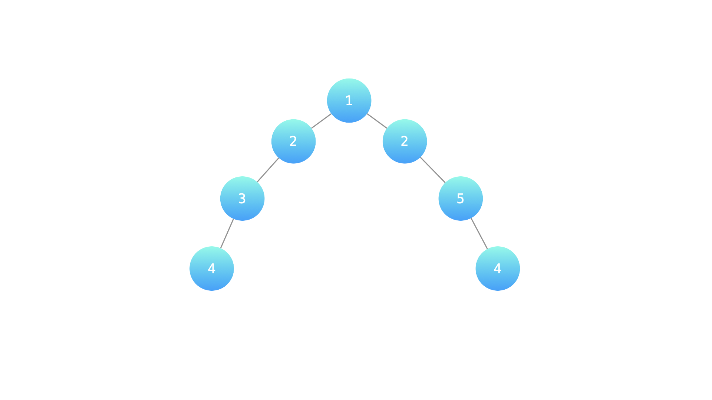

# 【视频】看完这个视频，让你对递归的理解更上一层楼！（Python/Java/C++/Go）

> **[LCR 175. 计算二叉树的深度](https://leetcode.cn/problems/er-cha-shu-de-shen-du-lcof/solutions/2010695/kan-wan-zhe-ge-shi-pin-rang-ni-dui-di-gu-h1j7/) · Easy**

> **题目描述**
> 某公司架构以二叉树形式记录，请返回该公司的层级数。
>
> **示例 1：**
>
> 
>
> ```
>
> 输入：root = [1, 2, 2, 3, null, null, 5, 4, null, null, 4]
> 输出: 4
> 解释: 上面示例中的二叉树的最大深度是 4，沿着路径 1 -> 2 -> 3 -> 4 或 1 -> 2 -> 5 -> 4 到达叶节点的最长路径上有 4 个节点。
> ```
>
> **提示：**
>
> - `节点总数 <= 10000`
>
> 注意：本题与主站 104 题相同：[https://leetcode.cn/problems/maximum-depth-of-binary-tree/](https://leetcode.cn/problems/maximum-depth-of-binary-tree/)

> **题解**
> ## 视频讲解
>
> 请看[【基础算法精讲 09】](https://www.bilibili.com/video/BV1UD4y1Y769/)，制作不易，欢迎点赞~
>
> ## 方法一：不用全局变量
>
> ```python
> class Solution:
>     def calculateDepth(self, root: Optional[TreeNode]) -> int:
>         if root is None: return 0
>         l_depth = self.calculateDepth(root.left)
>         r_depth = self.calculateDepth(root.right)
>         return max(l_depth, r_depth) + 1
> ```
>
>
> #### 复杂度分析
>
> - 时间复杂度：$O(n)$，其中 $n$ 为二叉树的节点个数。
> - 空间复杂度：$O(n)$。最坏情况下，二叉树退化成一条链，递归需要 $O(n)$ 的栈空间。
>
> ## 方法二：用全局变量
>
> ```python
> class Solution:
>     def calculateDepth(self, root: Optional[TreeNode]) -> int:
>         ans = 0
>         def dfs(node, cnt):
>             if node is None:
>                 return
>             cnt += 1
>             nonlocal ans
>             ans = max(ans, cnt)
>             dfs(node.left, cnt)
>             dfs(node.right, cnt)
>         dfs(root, 0)
>         return ans
> ```
>
>
> #### 复杂度分析
>
> - 时间复杂度：$O(n)$，其中 $n$ 为二叉树的节点个数。
> - 空间复杂度：$O(n)$。最坏情况下，二叉树退化成一条链，递归需要 $O(n)$ 的栈空间。
>
> ## 注
>
> 我在网上看到一种理解递归的说法：「在写递归函数时，可以假设递归返回的结果一定是正确的」。其实这种说法本质上就是数学归纳法。
>
> ## 题单
>
> - [滑动窗口（定长/不定长/多指针）](https://leetcode.cn/circle/discuss/0viNMK/)
> - [二分算法（二分答案/最小化最大值/最大化最小值/第K小）](https://leetcode.cn/circle/discuss/SqopEo/)
> - [单调栈（矩形系列/字典序最小/贡献法）](https://leetcode.cn/circle/discuss/9oZFK9/)
> - [网格图（DFS/BFS/综合应用）](https://leetcode.cn/circle/discuss/YiXPXW/)
> - [位运算（基础/性质/拆位/试填/恒等式/贪心/脑筋急转弯）](https://leetcode.cn/circle/discuss/dHn9Vk/)
> - [图论算法（DFS/BFS/拓扑排序/最短路/最小生成树/二分图/基环树/欧拉路径）](https://leetcode.cn/circle/discuss/01LUak/)
>
> 更多题单，请点我个人主页 - 讨论发布。
