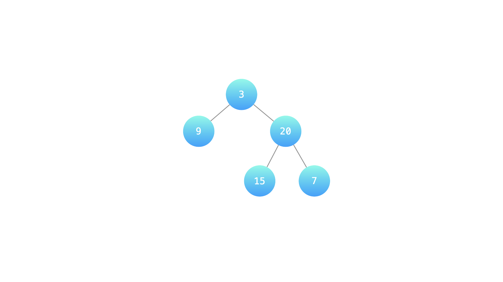
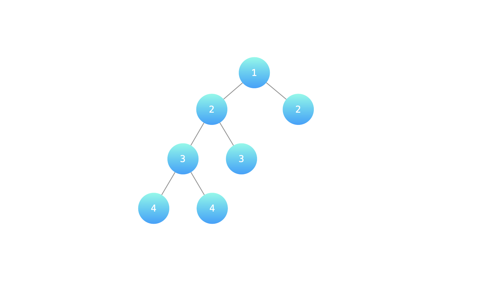

# 【视频】如何灵活运用递归？让你对递归的理解更上一层楼！（Python/Java/C++/Go）

> **[LCR 176. 判断是否为平衡二叉树](https://leetcode.cn/problems/ping-heng-er-cha-shu-lcof/solutions/2231088/shi-pin-ru-he-ling-huo-yun-yong-di-gui-r-p925/) · Easy**

> **题目描述**
> 输入一棵二叉树的根节点，判断该树是不是平衡二叉树。如果某二叉树中任意节点的左右子树的深度相差不超过1，那么它就是一棵平衡二叉树。
>
> **示例 1：**
>
> ```
>
> 输入：root = [3,9,20,null,null,15,7]
> 输出：true
> 解释：如下图
> ```
>
> 
>
> **示例 2：**
>
> ```
>
> 输入：root = [1,2,2,3,3,null,null,4,4]
> 输出：false
> 解释：如下图
> ```
>
> 
>
> **提示：**
>
> - `0 <= 树的结点个数 <= 10000`
>
> 注意：本题与主站 110 题相同：[https://leetcode.cn/problems/balanced-binary-tree/](https://leetcode.cn/problems/balanced-binary-tree/)

> **题解**
> ## 视频讲解
>
> 看完这两期视频，让你对递归的理解更上一层楼！
>
> [【基础算法精讲 09】](https://www.bilibili.com/video/BV1UD4y1Y769/)
>
> [【基础算法精讲 10】](https://www.bilibili.com/video/BV18M411z7bb/)
>
> 制作不易，欢迎点赞！
>
> ```python
> class Solution:
>     def isBalanced(self, root: Optional[TreeNode]) -> bool:
>         def get_height(node: Optional[TreeNode]) -> int:
>             if node is None: return 0
>             left_h = get_height(node.left)
>             if left_h == -1: return -1  # 提前退出，不再递归
>             right_h = get_height(node.right)
>             if right_h == -1 or abs(left_h - right_h) > 1: return -1
>             return max(left_h, right_h) + 1
>         return get_height(root) != -1
> ```
>
>
> #### 复杂度分析
>
> - 时间复杂度：$O(n)$，其中 $n$ 为二叉树的节点个数。
> - 空间复杂度：$O(n)$。最坏情况下，二叉树退化成一条链，递归需要 $O(n)$ 的栈空间。
