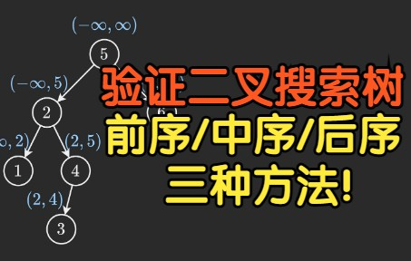

# 前序中序后序，三种方法，一个视频讲透！（Python/Java/C++/Go）

> **[面试题 04.05. 合法二叉搜索树](https://leetcode.cn/problems/legal-binary-search-tree-lcci/solutions/2021033/qian-xu-zhong-xu-hou-xu-san-chong-fang-f-90zr/) · Medium**

> **题目描述**
> 实现一个函数，检查一棵二叉树是否为二叉搜索树。
>
> **示例 1：**
>
> ```
>
> 输入：
>     2
>    / \
>   1   3
> 输出：true
> ```
>
> **示例 2：**
>
> ```
>
> 输入：
>     5
>    / \
>   1   4
>      / \
>     3   6
> 输出：false
> 解释：输入为: [5,1,4,null,null,3,6]。
>      根节点的值为 5 ，但是其右子节点值为 4 。
> ```

> **题解**
> 
>
> ### 视频讲解：[【基础算法精讲 11】](https://www.bilibili.com/video/BV14G411P7C1/)，制作不易，欢迎点赞~
>
> ---
>
> # 方法一：前序遍历
>
> ```python
> class Solution:
>     def isValidBST(self, root: Optional[TreeNode], left=-inf, right=inf) -> bool:
>         if root is None:
>             return True
>         x = root.val
>         return left < x < right and \
>                self.isValidBST(root.left, left, x) and \
>                self.isValidBST(root.right, x, right)
> ```
>
>
> #### 复杂度分析
>
> - 时间复杂度：$O(n)$，其中 $n$ 为二叉搜索树的节点个数。
> - 空间复杂度：$O(n)$。最坏情况下，二叉搜索树退化成一条链（注意题目没有保证它是**平衡**树），因此递归需要 $O(n)$ 的栈空间。
>
> # 方法二：中序遍历
>
> ```python
> class Solution:
>     pre = -inf
>     def isValidBST(self, root: Optional[TreeNode]) -> bool:
>         if root is None:
>             return True
>         if not self.isValidBST(root.left) or root.val <= self.pre:
>             return False
>         self.pre = root.val
>         return self.isValidBST(root.right)
> ```
>
>
> #### 复杂度分析
>
> - 时间复杂度：$O(n)$，其中 $n$ 为二叉搜索树的节点个数。
> - 空间复杂度：$O(n)$。最坏情况下，二叉搜索树退化成一条链（注意题目没有保证它是**平衡**树），因此递归需要 $O(n)$ 的栈空间。
>
> # 方法三：后序遍历
>
> ```python
> class Solution:
>     def isValidBST(self, root: Optional[TreeNode]) -> bool:
>         def dfs(node: Optional[TreeNode]) -> Tuple:
>             if node is None:
>                 return inf, -inf
>             l_min, l_max = dfs(node.left)
>             r_min, r_max = dfs(node.right)
>             x = node.val
>             # 也可以在递归完左子树之后立刻判断，如果不是二叉搜索树，就不用递归右子树了
>             if x <= l_max or x >= r_min:
>                 return -inf, inf
>             return min(l_min, x), max(r_max, x)
>         return dfs(root)[1] != inf
> ```
>
>
> #### 复杂度分析
>
> - 时间复杂度：$O(n)$，其中 $n$ 为二叉搜索树的节点个数。
> - 空间复杂度：$O(n)$。最坏情况下，二叉搜索树退化成一条链（注意题目没有保证它是**平衡**树），因此递归需要 $O(n)$ 的栈空间。
>
> #### 点评
>
> - 前序遍历在某些数据下不需要递归到边界（base case）就能返回，而另外两种至少要递归到一个边界，从这个角度上来说它是最快的。
> - 中序遍历很好地利用了二叉搜索树的性质，使用到的变量最少。
> - 后序遍历的思想是最通用的，即自底向上计算子问题的过程。想要学好动态规划的话，请务必掌握这个思想。
