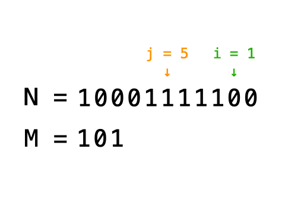

# 面试题 05.01. 插入

Easy · [力扣原题](https://leetcode.cn/problems/insert-into-bits-lcci/)

所在刷题路径：灵神题单·位运算

| 作者 | 题解 | 动画讲解 |
|---|---|---|
| 灵茶山艾府 | [📄 题解](灵茶山艾府.md) | [▶︎ 动画（GIF）](面试题%2005.01%20插入%20·%20灵茶山艾府.gif) · [mp4 文件](面试题%2005.01%20插入%20·%20灵茶山艾府.mp4) |
| yiduobo | — | — |

## 动画讲解

> 动图会循环播放；想暂停、拖进度条请下载上面表格里的 mp4 文件。

### 灵茶山艾府


## 题目描述

给定两个整型数字 `N` 与 `M`，以及表示比特位置的 `i` 与 `j`（`i <= j`，且从 0 位开始计算）。

编写一种方法，使 `M` 对应的二进制数字插入 `N` 对应的二进制数字的第 `i ~ j` 位区域，不足之处用 `0` 补齐。具体插入过程如图所示。



题目保证从 `i` 位到 `j` 位足以容纳 `M`， 例如： `M = 10011`，则 `i～j` 区域至少可容纳 5 位。

**示例 1：**

```

 输入：N = 1024(10000000000), M = 19(10011), i = 2, j = 6
 输出：N = 1100(10001001100)
```

**示例 2：**

```

 输入：N = 0, M = 31(11111), i = 0, j = 4
 输出：N = 31(11111)
```

---
[↑ 返回 面试题](../README.md) · [总索引](../../../索引.md) · [仓库首页](../../../README.md)
