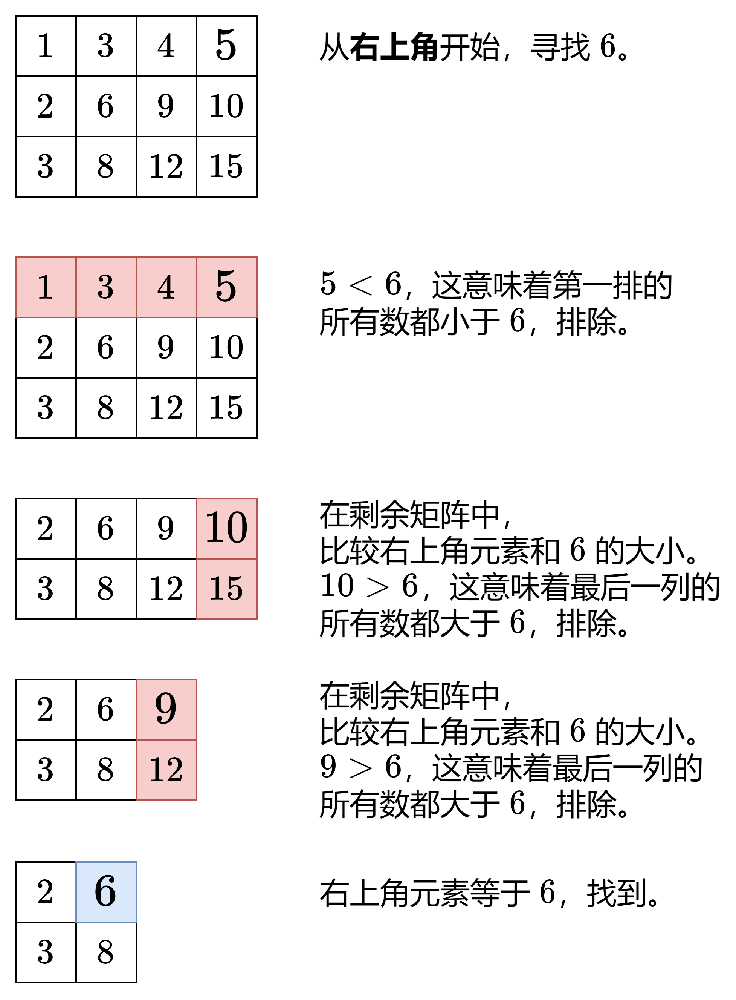

# 【图解】排除法，一图秒懂！（Python/Java/C++/C/Go/JS）

> **[面试题 10.09. 排序矩阵查找](https://leetcode.cn/problems/sorted-matrix-search-lcci/solutions/2866707/tu-jie-pai-chu-fa-yi-tu-miao-dong-python-ed0y/) · Medium**

> **题目描述**
> 给定 M×N 矩阵，每一行、每一列都按升序排列，请编写代码找出某元素。
>
> **示例：**
>
> 现有矩阵 matrix 如下：
>
> ```
>
> [
>   [1,   4,  7, 11, 15],
>   [2,   5,  8, 12, 19],
>   [3,   6,  9, 16, 22],
>   [10, 13, 14, 17, 24],
>   [18, 21, 23, 26, 30]
> ]
> ```
>
> 给定 target = `5`，返回 `true`。
>
> 给定 target = `20`，返回 `false`。

> **题解**
> 
>
> > 注：也可以从矩阵左下角开始，方法类似。
>
> ```python
> class Solution:
>     def searchMatrix(self, matrix: List[List[int]], target: int) -> bool:
>         if not matrix:
>             return False
>         m, n = len(matrix), len(matrix[0])
>         i, j = 0, n - 1  # 从右上角开始
>         while i < m and j >= 0:  # 还有剩余元素
>             if matrix[i][j] == target:
>                 return True  # 找到 target
>             if matrix[i][j] < target:
>                 i += 1  # 这一行剩余元素全部小于 target，排除
>             else:
>                 j -= 1  # 这一列剩余元素全部大于 target，排除
>         return False
> ```
>
>
> #### 复杂度分析
>
> - 时间复杂度：$\mathcal{O}(m+n)$，其中 $m$ 和 $n$ 分别为 $\textit{matrix}$ 的行数和列数。
> - 空间复杂度：$\mathcal{O}(1)$。
>
> ## 分类题单
>
> [如何科学刷题？](https://leetcode.cn/circle/discuss/RvFUtj/)
>
> 1. [滑动窗口（定长/不定长/多指针）](https://leetcode.cn/circle/discuss/0viNMK/)
> 2. [二分算法（二分答案/最小化最大值/最大化最小值/第K小）](https://leetcode.cn/circle/discuss/SqopEo/)
> 3. [单调栈（基础/矩形面积/贡献法/最小字典序）](https://leetcode.cn/circle/discuss/9oZFK9/)
> 4. [网格图（DFS/BFS/综合应用）](https://leetcode.cn/circle/discuss/YiXPXW/)
> 5. [位运算（基础/性质/拆位/试填/恒等式/思维）](https://leetcode.cn/circle/discuss/dHn9Vk/)
> 6. [图论算法（DFS/BFS/拓扑排序/最短路/最小生成树/二分图/基环树/欧拉路径）](https://leetcode.cn/circle/discuss/01LUak/)
> 7. [动态规划（入门/背包/状态机/划分/区间/状压/数位/数据结构优化/树形/博弈/概率期望）](https://leetcode.cn/circle/discuss/tXLS3i/)
> 8. [常用数据结构（前缀和/差分/栈/队列/堆/字典树/并查集/树状数组/线段树）](https://leetcode.cn/circle/discuss/mOr1u6/)
> 9. [数学算法（数论/组合/概率期望/博弈/计算几何/随机算法）](https://leetcode.cn/circle/discuss/IYT3ss/)
> 10. [贪心算法（基本贪心策略/反悔/区间/字典序/数学/思维/脑筋急转弯/构造）](https://leetcode.cn/circle/discuss/g6KTKL/)
>
> [我的题解精选（已分类）](https://github.com/EndlessCheng/codeforces-go/blob/master/leetcode/SOLUTIONS.md)
>
> 欢迎关注 [B站@灵茶山艾府](https://space.bilibili.com/206214)
